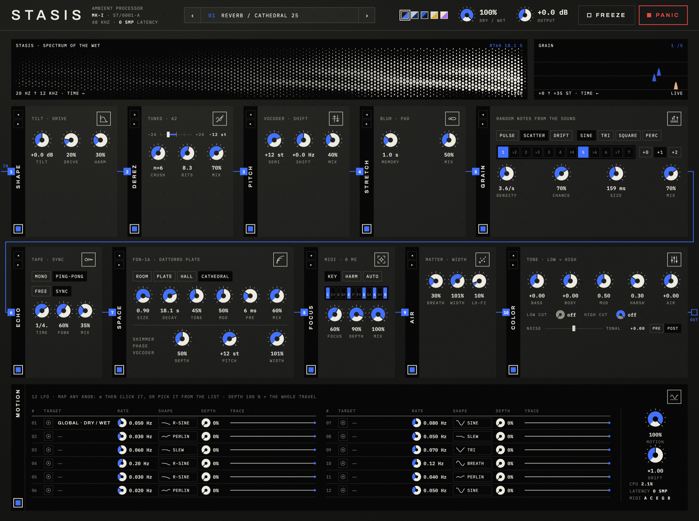

# STASIS

**Rack d'effets ambient** — reverbs profondes, échos à bande, time-stretch façon PaulXStretch, DeRez accordé et filtrage harmonique piloté par MIDI, dans une seule chaîne pensée pour les pads, les synthés et les enregistrements.

VST3 · Windows & macOS · JUCE 8 · v0.1 (en développement)



---

## Sommaire
- [Principes](#principes)
- [La chaîne](#la-chaîne)
- [Les modules](#les-modules)
- [Installation](#installation)
- [Utilisation dans Ableton Live](#utilisation-dans-ableton-live)
- [Compiler](#compiler)
- [Organisation du code](#organisation-du-code)
- [Mesures et tests](#mesures-et-tests)
- [Feuille de route](#feuille-de-route)
- [Licences](#licences)

---

## Principes
- **Qualité DSP maximale, CPU minimal.** Chaque algorithme est mesuré : densité d'écho, résonances, justesse, séparation tonal/bruit, coût CPU.
- **Le dry n'est jamais retardé.** La latence déclarée à l'hôte est de **0 échantillon**. Les modules qui ont besoin de temps (STRETCH, TONAL) ne retardent que le wet, où un décalage est musicalement invisible.
- **Peu de boutons, chacun utile.** Trois à six potards par module ; tous les paramètres sont automatisables.
- **Design sobre** : design suisse, imprimé années 80, inspirations Gattaca, *Her*, Marathon — sans en copier aucun visuel.

## La chaîne

```
IN ─┬───────────────────────────────────────────────────────────────────────────┬─ MIX ─ OUT
    └ SHAPE ► DEREZ ► PITCH ► STRETCH ► GRAIN ► ECHO ► SPACE ► FOCUS ► AIR ► COLOR ► [TONAL] ┘
                 ▲                                     ▲
MIDI IN ─────────┴─────────────────────────────────────┘ (DEREZ, FOCUS)
```

- **L'ordre se choisit** : on attrape une carte par sa tranche verticale noire et on la dépose ailleurs, ou on utilise les flèches ◂ ▸ en haut de cette tranche. Un fil relie les modules dans l'ordre de traitement ; le petit carré numéroté à l'entrée de chaque carte donne sa place. L'ordre est sauvegardé avec le projet et avec les presets.
- Par défaut, le crunch et l'étirement nourrissent l'écho, qui nourrit la reverb.
- Le visualiseur, en haut, montre le spectre réel du wet.
- Chaque module a un interrupteur (le carré en bas de sa tranche) avec un fondu de 30 ms, sans clic.
- `DRY / WET` (en haut, 100 % par défaut) dose le wet par rapport au dry, `OUTPUT` règle le niveau de sortie (±12 dB).
- **Limiteur de sécurité invisible** en toute fin : rien ne dépasse −0,3 dBFS, et si un bug produisait des valeurs aberrantes (NaN), la sortie se coupe 0,25 s et le moteur se réinitialise. Les oreilles ne risquent rien.
- `FREEZE` fige la reverb : la queue tient indéfiniment, sans dériver.
- `PANIC` (rouge, en haut à droite) : silence immédiat, vide toutes les queues et mémoires (reverb, écho, stretch, capture, notes tenues) et relâche FREEZE. Les réglages, l'ordre et MOTION ne bougent pas.

## Les modules

### SHAPE — la première touche
| Contrôle | Effet |
|---|---|
| `TYPE` | La façon dont DRIVE tord l'onde (voir ci-dessous) |
| `TILT` | Bascule ±6 dB autour de 800 Hz : sombre ◂▸ brillant |
| `DRIVE` | Quantité ; le niveau reste le même à −12 dBFS quel que soit le type |
| `HARM` | Asymétrie : harmoniques paires, chaleur « lampe » |

| Type | Caractère |
|---|---|
| `TAPE` | tanh sans repliement (ADAA) : rond, chaud, le classique |
| `TUBE` | Exponentielle asymétrique : le haut de l'onde s'adoucit plus tôt que le bas ; harmoniques paires même sans HARM |
| `FOLD` | Repli d'onde (sinus) : au-delà du plein niveau, l'onde se replie sur elle-même ; cloches, harmoniques de verre, « west coast » |
| `RECT` | Mélange l'onde redressée : une octave au-dessus apparaît (fuzz octaver) |
| `SLEW` | Limite la vitesse de l'onde : les fronts deviennent des rampes ; un grain doux, fantomatique, qui suit la hauteur (sur des aigus forts, un léger sous-son reste audible) |
| `BLOOM` | Le drive suit le niveau à l'envers : les attaques restent propres, les déclins et les queues de reverb s'encrassent en s'éteignant |

Tous les types sauf TAPE tournent suréchantillonnés ×2 ; repliement mesuré à 3,1 kHz −3 dBFS : de −21 dB (RECT) à −50 dB (BLOOM).

### PITCH — transposition et décalage
| Contrôle | Effet |
|---|---|
| `SEMI` | Transposition −24 … +24 demi-tons (phase vocoder, justesse ±0,5 Hz à 440 Hz) |
| `SHIFT` | Décalage de fréquence ±50 Hz (réglage fin au centre) : toutes les fréquences bougent du même nombre de Hz, de battements lents (±1 Hz) au métallique. Bande parasite −43 à −49 dB |
| `MIX` | Dosage |

### AIR — matière et largeur
| Contrôle | Effet |
|---|---|
| `BREATH` | Souffle (2–9 kHz) qui suit l'enveloppe du son et s'arrête avec lui |
| `WIDTH` | Largeur stéréo, de mono à 150 % |
| `LO-FI` | Support usé : aigus qui se ferment (16 → 3,5 kHz), résolution qui baisse, crêtes arrondies |

### DEREZ — réduction de résolution *accordée*
Inspiré du DeRez d'Airwindows, mais au lieu de changer la hauteur de façon chaotique, la fréquence d'échantillonnage réduite est calée sur la note jouée : le repliement tombe sur un intervalle musical.

| Contrôle | Effet |
|---|---|
| Curseur `−24 … +24` | Hauteur du repliement, au demi-ton (repères à chaque octave) |
| `CRUSH` | Force de la réduction (n = rapport à la fondamentale) |
| `BITS` | Profondeur, de 16 à 2 bits |
| `MIX` | Dosage |

La fondamentale vient de la note MIDI la plus grave tenue, sinon La2 (110 Hz). Mesure : 100 % de l'énergie reste juste, contre 9 à 77 % pour un DeRez classique.

### 04 · STRETCH — un pad continu (BLUR)
Étire en permanence **ce qui est joué maintenant** : trames FFT de 32768 points à phases aléatoires (comme PaulStretch), spectre moyenné dans le temps. Les notes montent et s'éteignent en douceur ; le pad ne s'arrête jamais et ne saute jamais.

| Contrôle | Effet |
|---|---|
| `MEMORY` | Durée sur laquelle le pad se souvient du jeu : 0,1 s à 2 min (1 s par défaut) |
| `MIX` | Dosage |

Un test vérifie qu'un clic ressort en souffle lisse et jamais en répétitions (`stasis_render --analyse`).

### GRAIN — des notes séparées, tirées du son
Rejoue de petits bouts de ce qui vient d'être joué, sous une enveloppe, à des moments aléatoires et transposés vers des intervalles choisis : un son continu devient une multitude de notes séparées. Placé par défaut juste après STRETCH (l'écho et la reverb en font un nuage).

| Contrôle | Effet |
|---|---|
| `PULSE` / `SCATTER` / `DRIFT` | Hasard : horloge régulière (CHANCE saute des coups) ; écarts aléatoires (Poisson) ; vitesse qui dérive lentement (×0,25 à ×4) : grappes puis silences |
| `SINE` / `TRI` / `SQUARE` / `PERC` | Enveloppe de chaque grain (SQUARE a des rampes de 2 %, sans clic ; PERC attaque vite et décroît) |
| Clavier (Do → Si) | Transpositions autorisées au-dessus du son joué : Do = unisson, Sol = quinte, etc. (touches blanches et noires comme un piano) |
| `+0` / `+1` / `+2` | Octaves : l'ensemble choisi est répété 1, 2 ou 3 octaves plus haut. Ça élargit la tessiture, sans transposer le reste |
| `FREE` / `SYNC` | FREE : `DENSITY` en grains par seconde (0,5 à 40). SYNC : `RATE` en division du tempo de l'hôte (1/32 à 1/1, pointées, triolets) ; en PULSE, les grains tombent sur la grille du morceau, en SCATTER / DRIFT le hasard reste autour de cette cadence |
| `CHANCE` | Probabilité qu'un grain prévu joue vraiment |
| `SIZE` | 20 ms à 2 s |
| `MIX` | Dosage (à 100 % : seulement les notes) |

Le petit écran **GRAIN**, en haut à droite, dessine chaque grain par un hexagone : sa hauteur donne la transposition (lignes = octaves), sa taille son volume, sa couleur son octave (blanc, bleu, pêche). Mesuré sur un son continu à 220 Hz (unisson + quinte, +1 octave) : 66 % de silence entre les notes, énergie sur 220 / 330 / 440 / 660 Hz, une note non autorisée 50 dB plus bas.

### 05 · ECHO — écho à bande
Saturation (tanh anti-repliement), filtres de bande et souffle dans la boucle, sans wow ni flutter : les répétitions restent justes. Les changements de temps glissent comme une bande qui change de vitesse.

| Contrôle | Effet |
|---|---|
| `MONO` / `PING-PONG` | Répétitions au centre ou alternées gauche/droite |
| `FREE` / `SYNC` | Temps libre (20 ms – 2,5 s) ou calé sur le tempo de l'hôte (1/32 à 1/1, pointées, triolets) |
| `TIME`, `FDBK` | Temps, réinjection |
| `MIX` | Niveau des répétitions |

### 06 · SPACE — les reverbs
| Type | Moteur |
|---|---|
| `ROOM` / `HALL` / `CATHEDRAL` | FDN 16 lignes : diffuseur 8 canaux, matrice Householder + rotation (aucune ligne ne se réinjecte elle-même), absorption 3 bandes, modulation qui s'adapte à la durée |
| `PLATE` | Plaque de Dattorro |

| Contrôle | Effet |
|---|---|
| `SIZE`, `DECAY`, `TONE` | Taille, durée (0,5 s à ∞), brillance de la queue |
| `MOD`, `PRE`, `MIX` | Modulation, prédélai (1 à 500 ms), dosage |
| `SHIMMER DEPTH` / `PITCH` | Part de la réinjection transposée par phase vocoder, de −24 à +24 demi-tons |
| `WIDTH` | Largeur stéréo |

Mesures : hall dense en 90 ms, résonance résiduelle 0,027 ; dérive en freeze 0,01 dB/min.

### 07 · FOCUS — le wet qui suit le MIDI
Garde dans le wet les fréquences des notes jouées et atténue le reste, dont la queue de l'accord précédent. **Zéro latence** (banc de filtres résonants).

| Contrôle | Effet |
|---|---|
| `KEY` | Garde les notes tenues, à toutes les octaves |
| `HARM` | Garde les notes et leurs harmoniques (peignes accordés) |
| `AUTO` | Sans MIDI : détecte lui-même les notes jouées |
| `FOCUS`, `DEPTH`, `MIX` | Précision, force, dosage |

Les notes suivies s'allument sur le clavier du module.

### 09 · COLOR — finition du wet
| Contrôle | Effet |
|---|---|
| `BASS` | Shelf ±9 dB à 120 Hz (en négatif, un passe-haut s'ajoute) |
| `BODY` | Cloche ±6 dB à 180 Hz : la chaleur du pad, sous la boue |
| `MUD` | Coupe 200–600 Hz, en partie **dynamique** : elle ne se creuse que si cette zone domine |
| `HARSH` | Même principe à 2–5 kHz : adoucit le verre des shimmers et des pads brillants |
| `AIR` | Shelf ±8 dB à 6 kHz |
| `LOW CUT` / `HIGH CUT` | Passe-haut 20 Hz – 1 kHz, passe-bas 1 – 20 kHz (12 dB/oct, *off* aux extrémités) |
| `NOISE ◂▸ TONAL` | À droite : ne garde que les notes. À gauche : ne garde que le souffle et la texture. Double-clic pour recentrer |
| `PRE` / `POST` | TONAL avant la reverb (elle reconstruit sa queue avec ce qui reste) ou après (on filtre la queue elle-même) |

Séparation mesurée : rapport notes/bruit de +7,6 dB en entrée → **+17,1 dB** à fond TONAL, **−1,8 dB** à fond NOISE.

### 10 · MOTION — 12 LFO à assigner librement
Chaque ligne fait bouger **le potard de ton choix**. Par défaut, seule la ligne 1 est assignée, au DRY / WET global ; les autres sont vides.

| Contrôle | Effet |
|---|---|
| Cible | Clic sur le nom : liste des potards, rangée par module dans l'ordre de la chaîne (GLOBAL, SHAPE, DEREZ… COLOR), ou *Empty* |
| `◎` TOUCH | Arme la ligne : tous les potards assignables s'entourent, un clic sur l'un d'eux l'assigne (Échap pour annuler) |
| `RATE` | 0,001 à 20 Hz |
| Forme | Un clic passe à la suivante : sinus, triangle, scies, carré, S&H, slew, random sine, drunk, Perlin, chaos (Lorenz), breath |
| `DEPTH` | Part de la course **totale** du potard que la ligne balaie : à 100 %, il va de 0 à 100 % ; à 0 % (par défaut), la ligne ne fait rien et ne calcule rien |
| `MOTION` / `DRIFT` | Profondeur globale, vitesse globale (×0,25 à ×4) |

Le potard modulé affiche un arc et un point orange qui suivent le LFO ; survoler une ligne entoure sa cible. Les assignations sont sauvegardées avec le projet.

## Presets
60 presets d'usine, en trois familles de 20. Chacun arrive avec ses propres modulations MOTION (2 ou 3 lignes lentes, assorties au son), et une bonne partie utilise GRAIN. Clic sur le nom du preset pour ouvrir la liste, ‹ › pour passer au suivant. Ils apparaissent aussi comme *programmes* VST3 dans l'hôte.

| ECHO | REVERB | AMBIENT |
|---|---|---|
| Tape Memory | Cathedral 25 | Glacier |
| Dub Wash | Endless Hall | Frozen Orchard |
| Broken Cassette | Glass Plate | Dust & Breath |
| Ping-Pong Garden | Small Room Halo | Tuned Ruins |
| Infinite Tape | Shimmer Cascade | Pure Tones |
| Octave Repeats | Fifth Heaven | Monastery Tape |
| Slow Motion | Underworld | Sub Tide |
| Shimmer Delay | Dark Matter | Northern Lights |
| Triplet Rain | Focused Choir | Slow Bloom |
| Echoes of the Room | Bottomless | Infinite Drone |
| Grain Bells | Grain Cathedral | Music Box Fog |
| Tape Stutter | Crystal Hall | Pentatonic Rain |
| Warped Reel | Shimmer Grains | Hexagon Field |
| Dotted Haze | Breathing Room | Glass Rain |
| Slapback Tube | Velvet Plate | Minor Constellation |
| Fifth Echoes | Ghost Choir | Breathing Pad |
| Frequency Drift | Dirty Tails | Cloud Chamber |
| Granular Delay Cloud | Halo Infinity | Fourths Drift |
| Answering Machine | Metal Room | Lunar Tape |
| Long Goodbye | Sub Cavern | Distant Signals |


## Installation

### Windows (Ableton Live)
1. Ouvrir l'onglet **[Actions](../../actions)** du repo, choisir la dernière compilation réussie, télécharger l'artefact **STASIS-VST3-Windows**.
2. Dézipper : on obtient un dossier `STASIS.vst3`.
3. Le copier dans `C:\Program Files\Common Files\VST3\`.
4. Dans Live : *Options › Préférences › Plug-ins*, activer **Use VST3 Plug-in System Folders**, puis **Rescan**.

L'interface utilise WebView2, déjà présent sur Windows 10 et 11.

### macOS
Même chose avec l'artefact **STASIS-VST3-macOS**, à copier dans `~/Library/Audio/Plug-Ins/VST3/`. Le plugin n'est pas encore signé : au premier lancement, macOS peut demander une autorisation (*Réglages système › Confidentialité et sécurité*).

## Utilisation dans Ableton Live
- **Sur une piste audio ou un synthé** : glisser STASIS comme effet audio, après l'instrument.
- **Envoyer le MIDI à STASIS** (pour FOCUS et DEREZ) : créer une piste MIDI, régler sa sortie *MIDI To* sur la piste qui contient STASIS, puis choisir **STASIS** dans le second menu. Jouer sur cette piste : les notes s'allument dans FOCUS.
- **Sans MIDI** : FOCUS en `AUTO` détecte les notes ; DEREZ prend La2 comme fondamentale.
- **Tempo** : ECHO en `SYNC` suit le tempo du projet.
- **En send** : mettre `MIX` à 100 % et doser avec le retour d'effet.
- **Automation** : tous les potards apparaissent dans la liste des paramètres de Live, avec les mêmes unités qu'à l'écran.

## Compiler
Prérequis : CMake ≥ 3.22, un compilateur C++20, Git. JUCE 8 est téléchargé automatiquement par CMake.

### Windows
Visual Studio 2022 ou plus récent (charge de travail *Développement Desktop en C++*), puis le SDK WebView2 :
```bash
nuget install Microsoft.Web.WebView2 -OutputDirectory C:\webview2
cmake -S . -B build -A x64 -DSTASIS_BUILD_RENDER=OFF -DJUCE_WEBVIEW2_PACKAGE_LOCATION=C:\webview2
cmake --build build --config Release --target Stasis_VST3
```
Le plugin est dans `build/plugin/Stasis_artefacts/Release/VST3/STASIS.vst3`.

### macOS
```bash
cmake -S . -B build -G Ninja
cmake --build build
```
Produit le VST3, une application **Standalone** pratique pour tester sans DAW, le testeur `stasis_hosttest` et l'outil de rendu `stasis_render`.

### Intégration continue
Chaque `push` lance [`.github/workflows/build.yml`](.github/workflows/build.yml) : compilation Windows et macOS, test de charge, plugins en téléchargement.

## Organisation du code

| Dossier | Contenu |
|---|---|
| [`dsp/include/stasis/`](dsp/include/stasis) | Cœur DSP en C++20, header-only, **sans dépendance** : reverbs, écho, stretch, DeRez, FOCUS, COLOR, TONAL, LFO, FFT |
| [`plugin/Source/Params.h`](plugin/Source/Params.h) | La table des paramètres (dont les 12 lignes de MOTION), partagée par l'hôte, l'interface et le moteur |
| [`plugin/Source/Presets.h`](plugin/Source/Presets.h) | Les 60 presets d'usine |
| [`plugin/Source/Engine.h`](plugin/Source/Engine.h) | La chaîne audio complète, indépendante de JUCE |
| [`plugin/Source/Plugin*.cpp`](plugin/Source) | Processeur JUCE (MIDI, tempo, état) et éditeur WebView |
| [`design/mockup.html`](design/mockup.html) | L'interface : une page HTML embarquée dans le plugin. Ouverte dans un navigateur, elle fonctionne seule (maquette interactive, 5 thèmes) |
| [`plugin/HostTest/`](plugin/HostTest) | `stasis_hosttest` : charge le VST3 comme un DAW et le met sous pression |
| [`tools/render/`](tools/render) | `stasis_render` : rend des sons de test à travers chaque algorithme (WAV) et lance les mesures (`--analyse`) |
| [`PLAN.md`](PLAN.md) | Le plan détaillé : algorithmes, choix, mesures, décisions, feuille de route |

L'interface et l'hôte se parlent par les relais Web de JUCE 8 : chaque contrôle HTML porte l'`id` de son paramètre, et la synchronisation va dans les deux sens (automation, undo, presets). Le plugin envoie aussi 30 fois par seconde le spectre du wet au visualiseur et l'état (CPU, notes suivies).

## Mesures et tests

```bash
./build/stasis_render --analyse                     # mesures DSP (densité, justesse, DeRez, TONAL…)
./build/stasis_render                               # rendus WAV dans renders/
./build/plugin/stasis_hosttest_artefacts/Release/stasis_hosttest build/plugin/Stasis_artefacts/Release/VST3/STASIS.vst3
```

Le testeur d'hôte joue 12 s de son par configuration (44,1 / 48 / 96 kHz, buffers de 64 à 2048), avec de l'automation aléatoire, du MIDI et une sauvegarde/relecture de l'état, puis passe les 60 presets (la queue doit sonner, rester finie et sous 0 dBFS). Résultats sur Apple Silicon :

| Mesure | Résultat |
|---|---|
| CPU moyen | 1 à 3 % d'un cœur |
| Pire bloc en automation (64 éch. à 48 kHz) | 41 % du temps réel |
| Changement de tous les paramètres d'un coup | ~2 ms dans le moteur |
| Sortie | toujours finie, jamais d'emballement |

Les modules à FFT longue répartissent leur calcul sur plusieurs blocs audio : aucun pic de CPU, même avec des buffers très courts.

## Feuille de route
- [x] **Phase 0** — prototypes et mesures de tous les algorithmes clés
- [x] **Phase 1** — plugin VST3 (Windows prioritaire), interface intégrée, tests, CI
- [ ] Polices embarquées dans le plugin (aujourd'hui chargées depuis Google Fonts)
- [x] Ordre des modules au choix, 60 presets, MOTION, COLOR à 5 bandes + filtres
- [x] SHAPE, PITCH, AIR ; limiteur de sécurité
- [ ] Reverbs expérimentales : Spectral, Modal, Bloom, 80s
- [ ] AU, CLAP ; signature et installeurs

Détails dans [PLAN.md](PLAN.md).

## Licences
- Usage personnel pour l'instant ; publication open source prévue sous **GPLv3** si le résultat est bon.
- JUCE 8 est utilisé sous sa licence **AGPLv3** (ou commerciale).
- Le moodboard qui a inspiré le design est sous licence : aucun de ses visuels n'est reproduit.
